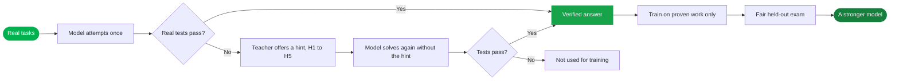
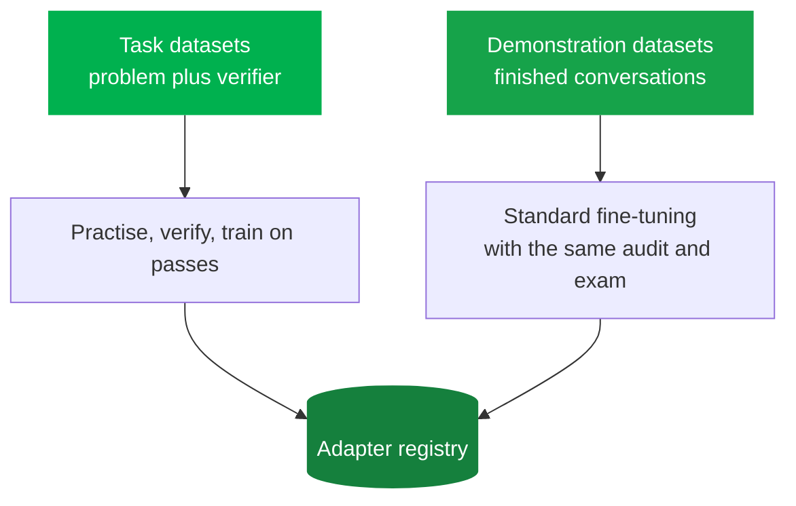
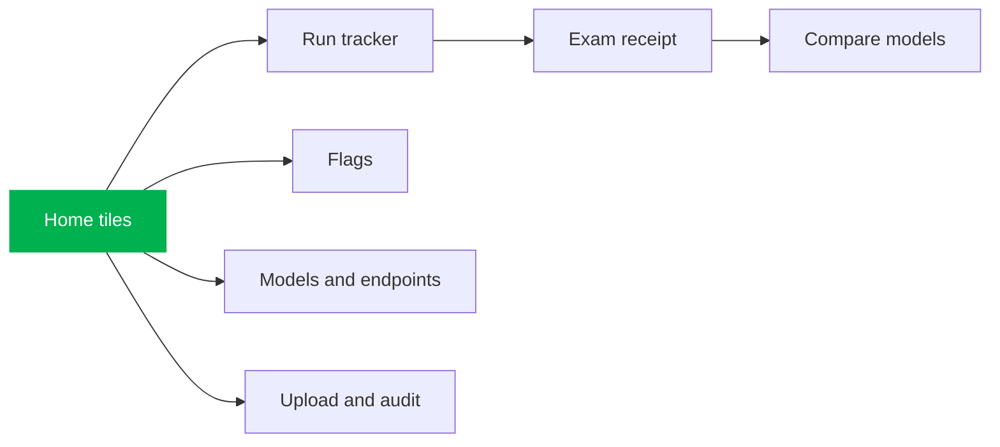
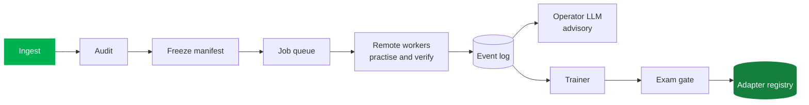

 

*A model training engine where the model practises, real tests check every answer, and only proven work is ever trained on.*

---

> **A showcase repository.** It contains no source code, only a tour of what VeriTrainer is and the experience it creates.
>
> 🔑 **VeriTrainer is in private early access.** It brings together proven ideas from published research into one effortless, end-to-end engine, so you do not have to assemble the pieces yourself.

## The idea

Most training pipelines learn from whatever data they are handed. VeriTrainer learns from what a model can actually **prove**. The model practises on real tasks, real tests grade every answer, a teacher gives gentle hints when it stumbles, and only answers that pass (and pass again without the hint) become training material. Every round ends with a fair, leak-checked exam, so progress is measured rather than assumed.

## The learning loop

Hints are gentle and never give the answer away: they get more specific one level at a time, and they are only ever shown while practising, never baked into what the model learns.

## Highlights

| | Feature | What it feels like |
|---|---|---|
| ✅ | **Learns only from proof** | Real tests grade every answer before it can teach anything |
| 🪜 | **Escalating hint ladder** | Five levels of hints from a nudge to a strong pointer, each checked so it never leaks the solution |
| 🔁 | **Hint-free re-solve** | A hint only counts if the model can then succeed on its own |
| 🧪 | **Fair, paired exams** | Every round is scored on a held-out set, compared against the previous best, and leak-checked |
| 🎯 | **Honesty tracking** | Measures whether a model's confidence matches its results |
| 🛡️ | **Dataset audit** | Friendly flags catch problems before a run starts: empty training masks, template mismatches, duplicate-heavy data, possible leaks between training and exam, truncation, sensitive data |
| 📦 | **Frozen manifests** | Every dataset version is fingerprinted, so any result can be traced back to exactly what it learned from |
| 🧰 | **Pluggable verifiers** | Code graders and test runners plug in behind one simple interface |
| 🔌 | **Bring your own models** | Student, teacher and judge roles are each swappable for any compatible endpoint |
| 🧑‍✈️ | **An LLM operator** | An assistant reads the reports and proposes the next round, while clear rules keep the decisions safe |
| 🌐 | **Spread across machines** | Practice runs shard across remote GPUs, so work finishes sooner |
| 🏁 | **Eval-gated promotion** | A new model is promoted only if it beats the last one on the exam |
| 🗂️ | **Adapter registry** | Every trained adapter is stored with its lineage, dataset version and exam report |

## Two kinds of datasets

## Early results

On a held-out set of 231 coding problems, an 8B-class open model improved markedly after a single verified round:

| Model | First try | After self-repair |
|---|---|---|
| Base | 21.6% | 25.5% |
| **After one verified round** | **35.5%** | **44.2%** |

That is a statistically significant gain on a leak-checked exam, from only 582 verified training rows. The next round adds the hint ladder and honesty training.

## The control room

A local web app gives training a calm, ride-tracker feel: service tiles on the home screen, a live tracker for each run, a receipt for every exam, side-by-side model comparison, a flags page, model and endpoint management, and dataset upload with an instant audit.

## The shape of the engine

---

**VeriTrainer** · crafted by [Zenix Developers](https://github.com/Zenix-Developers)

*The source code is private. Interested in a closer look? Get in touch.*

