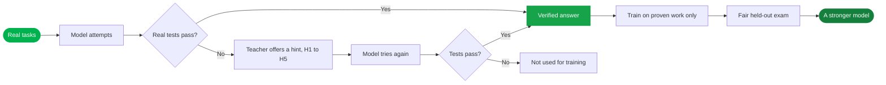
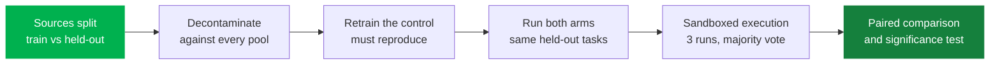
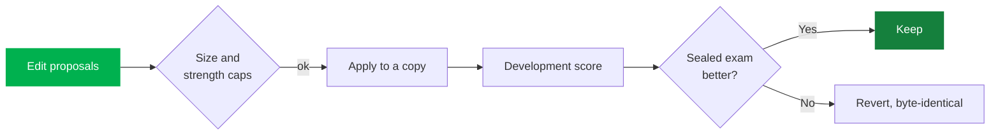
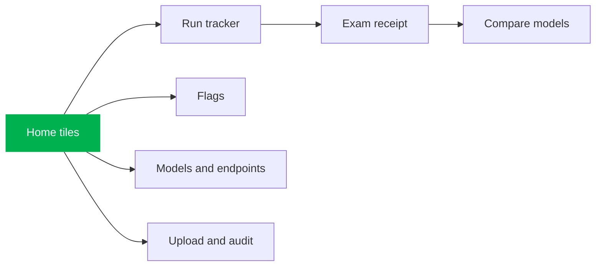
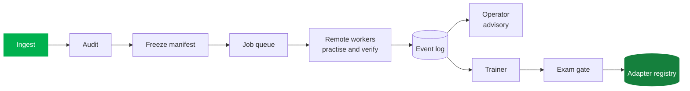

 

*A model training engine where the model practises, real tests check every answer, and only proven work is ever trained on.*

---

> **A showcase repository.** It contains no source code, only a tour of what VeriTrainer is and the experience it creates.
>
> 🔑 **VeriTrainer is in private early access.** It brings together proven ideas from published research into one end-to-end engine, so you do not have to assemble the pieces yourself.

## The idea

Most training pipelines learn from whatever data they are handed. VeriTrainer learns from what a model can actually **prove**. The model practises on real tasks, real tests grade every answer, a teacher gives gentle hints when it stumbles, and only answers that pass become training material. Every change is then judged on a fair, leak-checked exam against a control that has to reproduce first, so progress is measured rather than assumed.

## The learning loop

Hints get more specific one level at a time and never give the answer away. They guide practice only: a hint is never part of what the model is trained to say, so the model learns to find the solution on its own.

## Highlights

| | Feature | What it feels like |
|---|---|---|
| ✅ | **Learns only from proof** | Real tests grade every answer before it can teach anything |
| 🪜 | **Escalating hint ladder** | Five levels of hints from a nudge to a strong pointer |
| 🧪 | **Exams you can trust** | Held-out tasks from sources never used in training, leak-checked against every training pool, scored three times per item by majority vote |
| 🎛️ | **Controlled experiments** | Before any new idea is judged, the baseline is retrained and must reproduce its recorded scores. Every comparison is paired on the same tasks with a significance test |
| 🔒 | **Tamper-resistant grading** | Code runs in an isolated process; only a signed result report counts, never printed output or exit codes, and a must-fail tripwire runs every time |
| 🧮 | **Self-checking graders** | A maths grader must pass its own gate first: every correct answer passes, every wrong one fails, including traps |
| ✂️ | **Weight-space editing** | Small, reversible edits to a model's weights, plus surgical removal of heads, channels or layers, each kept only if a sealed exam says so |
| 📚 | **A research library as switches** | About 5,800 papers, each method built as a switchable part with its own exam, and negative results kept as control runs |
| 🛡️ | **Dataset audit** | Flags empty training masks, template mismatches, duplicates, leaks between training and exam, truncation, and leaked secrets in training data |
| 📦 | **Frozen manifests** | Every dataset version is fingerprinted, so any result traces back to exactly what it learned from |
| 🧰 | **Pluggable verifiers** | Code tests, maths equivalence, render checks and more behind one interface |
| 🔌 | **Bring your own models** | Student, teacher and judge roles are each swappable |
| 🌐 | **Spread across machines** | Jobs run on remote GPUs, resume after interruptions and stream results home as they finish |
| 🏁 | **Eval-gated promotion** | A new model is promoted only if it beats the last one on the exam |

## Exams you can trust

Results are also split into answers that finished and answers that ran out of room, so a length limit can never pose as a lack of skill.

## Results so far

**One verified round on an 8B-class open model**, 231 held-out coding problems:

| Model | First try | After self-repair |
|---|---|---|
| Base | 21.6% | 25.5% |
| **After one verified round** | **35.5%** | **44.2%** |

**Recovery training on a large open mixture-of-experts model**, on a single 96 GB GPU, 50 held-out coding problems run in a sandbox: **36% → 66% solved** (16 problems gained, 1 lost).

**Weight-space editing on a 2B multimodal model:**

| Check | Result |
|---|---|
| Edited model vs reference, outputs | match to within 0.00005 |
| Revert after an edit | byte-identical |
| Removing 93.5M parameters (heads, channels, a layer) | identical outputs to the masked model |
| Trimming the vocabulary to the tokens needed | 156 MB smaller, identical outputs |

**Prompt science.** On 180 held-out coding tasks, a 318-token guide beat a 44-token instruction by 35 tasks, and the engine traced the remaining gap to a single cause: the extra message switched the model's thinking on until it ran out of room. Findings like this decide how prompts are written for the model, before any training happens.

## Weight-space editing

Edits work on a per-layer copy of the weights, so a change touches only the files it changes, and every edit is hashed and reversible.

## The control room

A local web app gives training a calm, ride-tracker feel: service tiles on the home screen, a live tracker for each run, a receipt for every exam, side-by-side model comparison, a flags page, model and endpoint management, and dataset upload with an instant audit.

## The shape of the engine

---

**VeriTrainer** · crafted by [Zenix Developers](https://github.com/Zenix-Developers) · [zenix.sg](https://zenix.sg)

*The source code is private. Interested in a closer look? Get in touch.*

